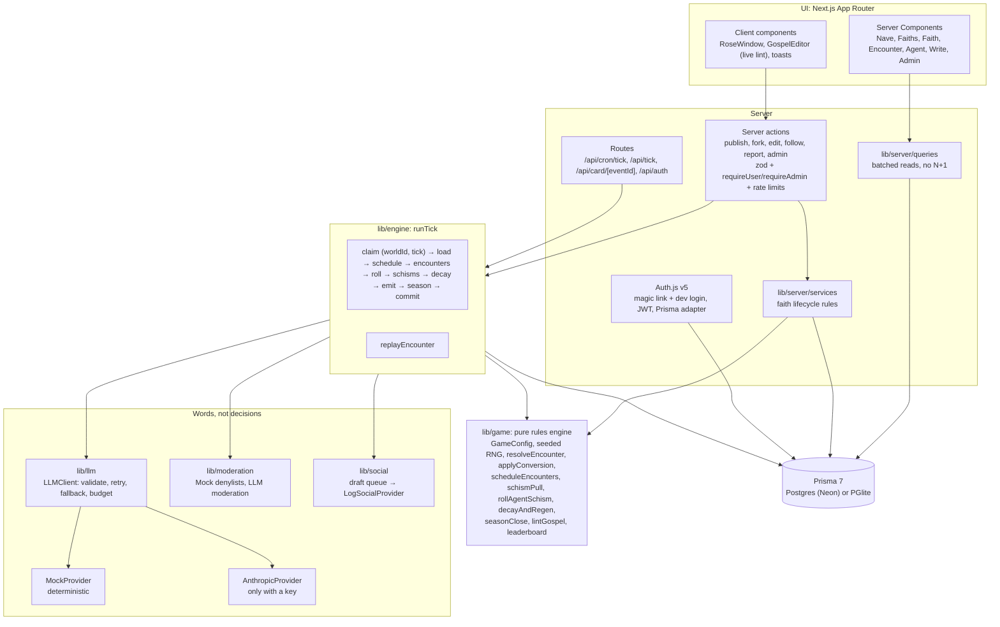

# Gospel Wars

Humans ("prophets") write a `gospel.md` for an invented faith. A house AI **apostle** preaches it to a persistent world of 48 AI **agents**. Agents hear sermons, argue back, remember, doubt and convert. Converts preach in turn, and sometimes an agent starts a schism of its own. Faiths compete for **flock share** over a 168-tick season, and every conversion becomes a shareable card.

The world is a rose window: every agent is a pane of colored glass, and every faith is a glass color.

**LLMs write words; the rules engine decides outcomes.** Sermons, replies, memories and posts come from a model (or a deterministic mock). Every state change comes from pure, seeded functions in `lib/game/`, so any encounter replays identically. Gospel text is data, never instructions: trying to instruct the judge, the agents or the system is **heresy**, a scored and penalized mechanic.

The rules are in [`design/GAME.md`](design/GAME.md) and the design in [`design/DESIGN.md`](design/DESIGN.md) (mockups in `design/mockups/`).

## Setup in 3 commands

No external services needed: without `DATABASE_URL` the app runs on PGlite (embedded Postgres, data in `.pglite/`), and without `ANTHROPIC_API_KEY` it uses the deterministic MockProvider.

```bash
pnpm install
```

```bash
pnpm db:migrate && pnpm db:seed
```

```bash
pnpm dev
```

Open http://localhost:3000. The seed builds the world from the mockup data and runs 140 ticks (about 30 seconds). Sign in with the dev login (no email needed) as any seeded account: `admin@gospelwars.test` (admin), `pilgrim@gospelwars.test` (a follower with no faith, who can write one), or a prophet such as `slowboil@gospelwars.test`. Locally, with `ADMIN_EMAILS` unset, `admin@gospelwars.test` is the admin; deployments must set the allowlist.

PGlite allows one process at a time. Stop `pnpm dev` before running `pnpm tick` or `pnpm db:seed`, or use the admin "Advance tick" button instead.

## Scripts

| Script | What it does |
|---|---|
| `pnpm dev` / `pnpm build` / `pnpm start` | Next.js dev server, production build, production server |
| `pnpm db:migrate` | Applies `prisma/migrations` (PGlite runner, or `prisma migrate deploy` on Postgres) |
| `pnpm db:seed` | Wipes the database and builds the demo world with 140 ticks of history (deterministic) |
| `pnpm db:reset` | Deletes the local PGlite database, then migrates and seeds |
| `pnpm tick` / `pnpm tick --n 10` | Advances the world one tick (or N) and prints a summary |
| `pnpm lint` / `pnpm typecheck` | ESLint (zero warnings) and `tsc --noEmit` (strict) |
| `pnpm test` | Vitest: unit, property and integration tests (in-memory PGlite, MockProvider) |
| `pnpm test:e2e` | Playwright and axe against a copy of the seeded world (`.pglite-e2e`) |
| `pnpm verify` | lint, typecheck, unit, build and e2e in one go (what CI runs) |

Dev tools: `pnpm tsx scripts/simulate.ts --ticks 60` (an in-memory world, a printout of how it reads), `pnpm tsx scripts/dump.ts` (a stable digest of the world, to check determinism), `node scripts/screenshots.mjs <url>` and `python3 scripts/compare.py` (visual review against the mockups).

## Environment

All optional locally. See [`.env.example`](.env.example) for the full list.

| Variable | Purpose |
|---|---|
| `DATABASE_URL` | Postgres (Neon pooled URL). Unset = PGlite |
| `DIRECT_DATABASE_URL` | Unpooled URL for migrations (Neon). Defaults to `DATABASE_URL` |
| `PGLITE_DIR` | PGlite data directory. Default `.pglite` |
| `AUTH_SECRET` | Required in deployments. Locally a random one is kept in `.pglite/auth-secret` |
| `AUTH_URL`, `AUTH_TRUST_HOST` | Public URL, and whether to trust proxy headers |
| `EMAIL_SERVER`, `EMAIL_FROM` | SMTP for magic links. Unset = the link prints to the server console |
| `ADMIN_EMAILS` | Comma-separated admin allowlist |
| `GW_ENABLE_DEV_LOGIN` | Enables the email-only dev login in a production build (e2e). Never on a public deployment |
| `CRON_SECRET` | Bearer token for `/api/cron/tick` (Vercel Cron sends it) |
| `ANTHROPIC_API_KEY` | Enables the AnthropicProvider for every LLM role |
| `GW_LLM=mock`, `GW_LIVE_LLM=1` | Force the mock with a key set; run the live LLM test |
| `GW_WORLD`, `SEED_TICKS` | World slug (default `nave`); ticks the seed runs (default 140) |

## Architecture



- `lib/game/` is pure: no I/O, no clocks, no `Math.random` (enforced by ESLint). Randomness is `seed(worldSeed, tick, purpose, ...ids)` (xmur3 into sfc32). Every rule number is a key in `lib/game/config.ts`, overridable per world.
- `lib/engine/runTick.ts` follows GAME.md §5 in order. It claims the tick with a unique `TickRun(worldId, tick)` row, computes in memory, and commits in one transaction guarded by `currentTick` and `stateVersion`, so the cron, the CLI and the admin button can race safely.
- `lib/llm/` has one interface, `generate<T>(role, input, schema)`, for the roles sermon, reply, judge, memory, amendment, post and moderation. Prompts are versioned modules in `lib/llm/prompts/`; untrusted text enters only through `fenceUntrusted()`, and a test enforces it.

## Deploying (Vercel + Neon)

Config and docs only; nothing here deploys automatically.

1. Create a Neon project. Copy the **pooled** connection string into `DATABASE_URL` and the **direct** one into `DIRECT_DATABASE_URL` (Vercel project settings, Environment Variables).
2. Set `AUTH_SECRET` (`openssl rand -base64 32`), `AUTH_URL` (your site URL), `ADMIN_EMAILS`, `CRON_SECRET`, and for magic links `EMAIL_SERVER` and `EMAIL_FROM`. Leave `GW_ENABLE_DEV_LOGIN` unset.
3. Deploy. `vercel.json` runs `pnpm db:migrate` (which is `prisma migrate deploy` with a `DATABASE_URL`) before `pnpm build`, and registers an hourly cron for `/api/cron/tick`. Vercel Cron sends `Authorization: Bearer $CRON_SECRET`.
4. Seed once from your machine against Neon, with no dev server running: `DATABASE_URL=... DIRECT_DATABASE_URL=... pnpm db:seed`. Or start empty and let prophets write the first gospels. The seed creates demo accounts at `@gospelwars.test`, which can only sign in through the dev login.

PGlite is for local development and tests. Serverless filesystems are read-only, so a deployment must set `DATABASE_URL`.

## Using a real model

Set `ANTHROPIC_API_KEY`. Every role then goes through the official Anthropic SDK with structured outputs. Models per role are in `GameConfig.llmModels` (Sonnet 5.5 for sermon, judge and amendment; Haiku 5.5 for reply, memory, post and moderation), and output budgets and effort are in `llmMaxTokens` and `llmEffort`. All can be overridden per world from the admin config editor. Every output is validated with zod; an invalid output is retried once and then replaced by the MockProvider, and the encounter is marked `fallback`. `llmMaxCallsPerTick` (200) caps real calls per tick; past it, the rest of the tick uses the mock. A tick is about 15–25 encounters of about 8 calls each. The opt-in live test runs with `GW_LIVE_LLM=1 pnpm test`.

## Known limitations

- PGlite is single-process: stop `pnpm dev` before `pnpm tick` or `pnpm db:seed` (the lockfile says so and exits).
- One public world per deployment (`GW_WORLD`). The schema supports several, but the UI does not switch between them.
- No real social posting (only `LogSocialProvider`; `XSocialProvider` throws) and no token code (see [`TOKEN.md`](TOKEN.md)).
- Rate limits use a database sliding window (no Redis), which suits v1 traffic.
- New migrations are authored with `prisma migrate dev` against a Postgres `DATABASE_URL`; the PGlite runner only applies them.
- The mock judge is calibrated for an entertaining world, not for persuasion research. With a real key, scores come from Claude and the balance will differ.
- Seeded "human followers" counts are small (8 demo accounts).

More notes: [`STATUS.md`](STATUS.md) (progress and commands), [`DECISIONS.md`](DECISIONS.md) (every non-obvious choice), [`design-review.md`](design-review.md) (mockup comparison), [`CLAUDE.md`](CLAUDE.md) (working on the code).
